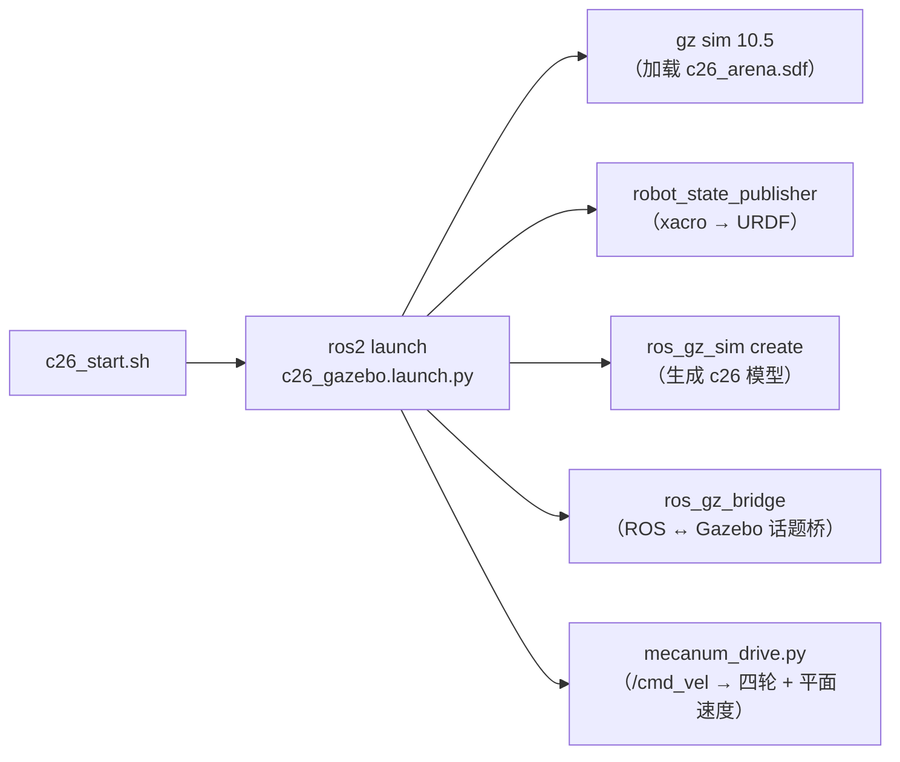

# C26 麦轮小车 · Gazebo 仿真操作笔记

> 把 `D:\learn\robot\07.图纸资料\106+C26小车图纸` 里的 C26 四轮麦轮小车放进虚拟机 Gazebo 仿真，并跑通遥控。
> 本笔记用于快速上手和日常操作。项目入口、模型、配置和地图的关系见 [室内导航代码结构图](C26_Gazebo仿真_使用说明.md#30-室内导航代码结构图)。

| 项目 | 值 |
|---|---|
| 仿真机 | VMware 虚拟机 `192.168.100.128`，Ubuntu 26.04.1 LTS，4 vCPU / 6 GB |
| 账号 | 用户 `xue`，SSH 密码在连接时输入 |
| ROS | ROS 2 **Lyrical**（`/opt/ros/lyrical`） |
| 仿真器 | Gazebo Sim **10.5.0**（ROS vendor 包，命令 `gz`） |
| 工作空间 | `~/c26_ws`（包名 `c26_car_description`） |
| 当前状态 | 支持键盘遥控、雷达建图、室内定位和自主绕障导航 |

---

## 0. 一分钟上手（TL;DR）

### 室内自主导航

在虚拟机桌面打开终端，启动 Gazebo 室内仿真、AMCL 和 RViz：

```bash
source /opt/ros/lyrical/setup.bash
source ~/c26_ws/install/setup.bash
ros2 launch c26_car_description c26_navigation.launch.py rviz:=true
```

1. 等 RViz 左侧显示 `Navigation: active`，点击上方的 **Nav2 Goal**。
2. 把鼠标移到希望小车**最终停下**的空地，再按住左键。箭头的起点就是目标位置。拖动只设置到达时的车头朝向，随后松开左键发送目标。
3. 第一次试绕障时，可以从左侧出生点选中**右边房间上半部的空地**，避开右上角柜子。绿色全局路径应穿过隔墙门洞。要单独测试绕货架，从出生点选择蓝色货架正后方、隔墙左侧的空地。货架内部和墙上没有可停靠的目标位置。

小车从固定出生点启动，AMCL 已配置该位置作为初值。**2D Pose Estimate** 用于纠正定位。结束时在启动终端按 `Ctrl+C`。

自主导航默认先对准路线再沿车头方向前进。到点后，小车可能继续原地转向，最终与选点时拖出的箭头方向对齐再停车。键盘遥控支持前后、左右横移和原地转向。Nav2 也保留了可选的 `CardinalDWB` 控制器，其 [DWB 轨迹评分插件](c26_ws/src/c26_car_description/src/cardinal_motion_critic.cpp) 允许纯横移，并约束斜向速度。

如果 RViz 窗口消失，先到原启动终端按 `Ctrl+C`，等命令提示符回来，再用上面的命令重开。若是通过 SSH 在后台启动的实例，可在虚拟机终端用 `ps -eo pid,args | grep '[r]os2 launch c26_car_description c26_navigation.launch.py'` 找到启动进程，运行 `kill -INT <PID>`（把 `<PID>` 换成查到的数字）。确认该进程退出后再重开，避免两套导航节点和仿真时钟同时运行。

想练习建图时，用 `mode:=mapping rviz:=true` 启动，再开一个终端运行 `bash ~/c26_keyboard.sh`。`/scan` 是实时雷达数据，`/map` 是 SLAM Toolbox 建出的地图。跑完一圈后可以另存地图：

```bash
ros2 run nav2_map_server map_saver_cli -f ~/c26_practice --fmt pgm --ros-args -p use_sim_time:=true
```

停止建图后，给导航启动命令加 `map:=$HOME/c26_practice.yaml` 即可尝试练习地图。

### 同时打开 Gazebo 3D 窗口

上面的导航命令会在后台运行 Gazebo 仿真服务。想看同一个场景的三维画面，在虚拟机另开一个终端：

```bash
source /opt/ros/lyrical/setup.bash
source ~/c26_ws/install/setup.bash
pkg=$(ros2 pkg prefix --share c26_car_description)
QT_QPA_PLATFORM=xcb QT_XCB_GL_INTEGRATION=xcb_glx \
LIBGL_ALWAYS_SOFTWARE=1 GZ_SIM_RESOURCE_PATH="$(dirname "$pkg")${GZ_SIM_RESOURCE_PATH:+:$GZ_SIM_RESOURCE_PATH}" \
gz sim -g "$pkg/worlds/c26_indoor.sdf"
```

`-g` 会让图形客户端连接已经运行的室内仿真。可以在 RViz 里发目标，在 Gazebo 里看小车如何走。

### 键盘遥控场地

- [ ] 打开虚拟机终端
- [ ] 启动仿真：`bash ~/c26_start.sh gui`
- [ ] 新开终端运行 `bash ~/c26_keyboard.sh`，在该终端按住 `i` 前进，按空格停车
- [ ] 收工必须跑：`bash ~/c26_stop.sh`

---

## 1. 启动 / 停止

### 1.1 启动

```bash
bash ~/c26_start.sh gui        # 带 Gazebo 界面（开在虚拟机桌面）
bash ~/c26_start.sh headless   # 只跑服务器，省资源，测算法用这个
```

启动脚本内部做的事：



启动成功的样子（约 20 秒后）：日志 `/tmp/c26_launch.log` 里出现
`VelocityControl subscribing to twist messages on [/model/c26/cmd_vel_planar]`。

### 1.2 停止（**必须用脚本**）

```bash
bash ~/c26_stop.sh
```

> ⚠️ 不要只用 `Ctrl+C`，也不要 `pkill -f "gz sim"`。真正的服务进程名是
> `gz-sim-main` 和 `gz-sim-gui-client`，杀错会残留多个仿真同时跑，
> 出现「车不动 / `/odom` 没数据」，日志里能看到
> `Another world of the same name is running`。

检查是否清理干净：

```bash
ps -eo pid,args | grep -c "[g]z-sim-main"   # 应该是 0
```

---

## 2. 操作小车

### 2.1 每次开新终端都要 source

```bash
source /opt/ros/lyrical/setup.bash
source ~/c26_ws/install/setup.bash
```

### 2.2 方式一：命令行给一次速度（最常用）

```bash
# 语法：c26_drive.py VX VY WZ [秒数]   （按仿真时间计时）
D=~/c26_ws/install/c26_car_description/lib/c26_car_description

python3 $D/c26_drive.py 0.20 0    0   2   # 前进 0.2 m/s，跑 2 秒
python3 $D/c26_drive.py -0.20 0   0   2   # 后退
python3 $D/c26_drive.py 0    0.20 0   2   # 向左横移（麦轮特有）
python3 $D/c26_drive.py 0   -0.20 0   2   # 向右横移
python3 $D/c26_drive.py 0    0    0.5 2   # 原地左转
python3 $D/c26_drive.py 0.15 0.10 0   3   # 斜着走
```

速度上限参考：整车最高 0.8 m/s，建议测试用 0.2~0.3。

### 2.3 方式二：键盘遥控

```bash
bash ~/c26_keyboard.sh
```

将焦点留在键盘终端。按住 `i` 前进、逗号后退，`j` / `l` 原地左转 / 右转，`Shift+J` / `Shift+L` 左移 / 右移。空格或 `k` 停车，`Ctrl+C` 退出。

### 2.4 方式三：直接发话题

```bash
# 左横移，10 Hz 持续发，Ctrl+C 停
ros2 topic pub -r 10 /cmd_vel geometry_msgs/msg/Twist "{linear: {y: 0.2}}"
```

### 2.5 运动学自检（改完模型/参数后跑一遍）

```bash
source /opt/ros/lyrical/setup.bash && source ~/c26_ws/install/setup.bash
python3 ~/c26_ws/install/c26_car_description/lib/c26_car_description/test_motion.py
```

会依次跑前进 / 后退 / 横移 / 旋转，打印每个指令的实测速度。参考值（planar 模式）：

| 指令 | 实测 | 达成率 |
|---|---|---|
| vx ±0.20 m/s | ±0.166 m/s | ~83% |
| vy ±0.20 m/s | ±0.155 m/s | ~78% |
| wz ±0.50 rad/s | ±0.35 rad/s | 70% |

方向正确就算通过；数值偏低是轮子接触拖拽，需要精确就跟指令乘 1.2~1.4。

---

## 3. 看状态 / 调试命令

```bash
ros2 topic list                    # 看所有话题
ros2 topic echo /odom --once       # 位姿（位置 + 四元数）
ros2 topic hz /joint_states        # 关节刷新率
ros2 topic echo /joint_states --once   # 四轮与 32 个滚子的转角/速度

gz topic -l | grep c26             # Gazebo 侧话题
gz topic -e -t /model/c26/pose/info -n 1   # 所有连杆位姿
gz model -m c26 --link             # 模型连杆列表（含质量/惯量）
```

话题速查：

| 话题 | 方向 | 类型 | 用途 |
|---|---|---|---|
| `/cmd_vel` | 订阅 | `geometry_msgs/Twist` | **唯一控制入口** |
| `/odom` | 发布 | `nav_msgs/Odometry` | 里程计 |
| `/joint_states` | 发布 | `sensor_msgs/JointState` | 轮子/滚子状态 |
| `/tf` `/tf_static` | 发布 | TF | 坐标树 |
| `/clock` | 发布 | `rosgraph_msgs/Clock` | 仿真时钟（节点需 `use_sim_time`） |
| `/c26/cmd_vel_wheel/wheel_xx` | 发布 | `std_msgs/Float64` | 四轮转速 rad/s |

---

## 4. 改模型 / 改代码后的重建流程

源码在虚拟机 `~/c26_ws/src/c26_car_description/`，Windows 侧备份在 `D:\robot\robot-simulate\c26_ws\src\`。

```bash
# 1) 改完文件后重新编译
source /opt/ros/lyrical/setup.bash
cd ~/c26_ws && colcon build --packages-select c26_car_description

# 2) 重启仿真让改动生效
bash ~/c26_stop.sh && bash ~/c26_start.sh gui
```

从 Windows 上传单个文件时使用 `D:\robot\robot-simulate\tools\vm.py`。按提示输入 SSH 密码，或通过当前终端的 `C26_VM_PASS` 环境变量提供密码。

```powershell
cd D:\robot\robot-simulate
python tools\vm.py --put c26_ws\src\c26_car_description\urdf\c26_car.urdf.xacro /home/xue/c26_ws/src/c26_car_description/urdf/c26_car.urdf.xacro
```

常改的两个地方：

| 文件 | 改什么 |
|---|---|
| `urdf/c26_car.urdf.xacro` | 顶部参数区（轮径、轮距、轴距、层高、质量） |
| `worlds/c26_arena.sdf` | 场地：地面、光照、参照物、后续巡线地图 |

---

## 5. 驱动模式（两个开关）

`planar_drive` 参数决定「轮速怎么变成车身运动」：

| 模式 | 启动方式 | 特点 | 用在哪 |
|---|---|---|---|
| **planar**（默认） | `c26_start.sh gui` | 轮子照常转（视觉正确）+ Gazebo 直接给车体平面速度 | 巡线、视觉、导航等上层算法测试 |
| wheel | `ros2 launch c26_car_description c26_gazebo.launch.py planar_drive:=false` | 纯四轮接触物理 | 想观察真实接触表现时 |

> planar 模式是仿真里的**妥协方案**：Gazebo 的麦轮滚子接触精度不够，
> 纯接触模式下横移/自转几乎不动；改成平面速度驱动后六个方向全部正确。

---

## 6. 常见问题速查

| 现象 | 原因 | 处理 |
|---|---|---|
| 车不动、`/odom` 没数据 | 残留多个 `gz-sim-main` 抢 `/clock` | `bash ~/c26_stop.sh`，再 `ps -eo args \| grep -c "[g]z-sim-main"` 确认 0 |
| **看不到小车** | 默认机位在原点外 8.5 m，车只有约 27 像素 | 已修：启动脚本用包里的 `config/gui.config`（机位在车旁 1.3 m）；手动改 `~/.gz/sim/10/gui.config` 里 `<camera_pose>0.85 -0.85 0.55 0 0.3948 2.3562</camera_pose>` |
| 画面闪烁 / 时有时无 | Wayland + VMware SVGA3D + ogre2 合成不稳 | 使用新版 `bash ~/c26_start.sh gui` 启动 |
| GUI 起不来，报 `could not connect to display :0` | 虚拟机是 Wayland，缺 Xwayland 授权 | 用 `c26_start.sh gui`（`~/c26_xenv.sh` 自动找授权文件，Xorg/Wayland 都兼容） |
| GUI 很卡 | 无 GPU 加速 | 正常；测算法用 `headless` |
| `gz: command not found` | 没 source ROS | `source /opt/ros/lyrical/setup.bash` |
| 横移/自转几乎不动 | 手动切成了 `planar_drive:=false` | 切回默认 planar |
| 车陷进地面或抖动 | 出生高度太低 | `--ros-args` 外再加 `spawn_z:=0.05` |
| 跑了 2 秒但距离很短 | GUI 下实时因子 <1 | `c26_drive.py` 已按仿真时间计时，属正常 |

### 6.1 界面问题的排查结论（2026-11-13）

图形闪烁的定位过程、修复和验证见 [C26 仿真排障记录](C26_仿真排障记录.md)第 01 条。

---

## 7. 关键路径

| 内容 | 路径 |
|---|---|
| 启动 / 停止 / 截图脚本 | `~/c26_start.sh`、`~/c26_stop.sh`、`~/c26_shot.sh` |
| ROS 包 | `~/c26_ws/src/c26_car_description/` |
| 编译产物 | `~/c26_ws/install/c26_car_description/` |
| 启动日志 | `/tmp/c26_launch.log` |
| 完整说明书 | [Gazebo 仿真使用说明](C26_Gazebo仿真_使用说明.md) |
| 宿主机 SSH 工具 | `D:\robot\robot-simulate\tools\vm.py` |

---

## 8. 还没做的（按优先级）

- [x] 用底板 DXF 细化上下层板的外观
- [ ] 从 `三维STEP通用格式\C26双层小车.STEP` 提取电机支架、联轴器等零件的外观网格
- [ ] 加机械臂（6 自由度，L0/L1/L2/L3 = 1000/1050/880/1550，PWM 500~2500 µs）
- [ ] 加 OpenMV 相机 → `/camera/image_raw`，复现视觉巡线/颜色/二维码逻辑
- [ ] 按项目笔记搭比赛场地（巡线、路口、AprilTag 色块）

---

## 附：模型凭什么这么建

| 参数 | 值 | 来源 |
|---|---|---|
| 底板 | 280 × 155 × 3 mm | `C26底板240712.dxf` 图纸实测 |
| 麦轮 | Ø65 mm，轮宽 38 mm | 《C26四轮底盘车使用手册》1.4 |
| 层间距 | 45 mm | 同上 |
| 轮距 / 轴距 | 207 / 210 mm | 按底板与轮架位置推算 |
| 电机 | 520 霍尔编码器，152 g | 同上 |
| 整车质量 | ≈ 2.0 kg | 按铝件/电池/电机累计估算 |

麦轮建模两个必须满足的条件（踩过坑）：

1. 轮毂直径必须**小于滚子外径**，否则轮毂直接蹭地，麦轮变普通轮；
2. 滚子必须用 **continuous 关节**自由自转，焊死就没法横移。
