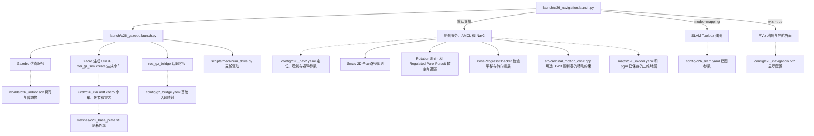

# C26 智能底盘车 · Gazebo 仿真使用说明

> 目标：把 `D:\learn\robot\07.图纸资料\106+C26小车图纸` 里这台 C26 四轮麦轮小车，放进虚拟机的
> Gazebo 仿真里跑起来。
> 当前状态：C26 支持键盘遥控、激光雷达建图，以及在室内地图上定位和自主绕障导航。

更新时间：2026-11-13

日常启动和遥控见 [仿真操作笔记](C26_Gazebo仿真_Notion笔记.md)。故障的定位与验证见 [C26 仿真排障记录](C26_仿真排障记录.md)。

---

## 1. 现在能做什么

| 能力 | 状态 | 说明 |
|---|---|---|
| 车体模型（底板 / 双层板 / 电池 / 主控板 / 4 个 520 电机 / 4 个麦轮） | ✅ | 尺寸按图纸与手册建模 |
| Gazebo 里生成、落地、静止稳定 | ✅ | 默认世界 `c26_arena.sdf` |
| 前进 / 后退 | ✅ | 实测误差 < 5% |
| 左 / 右横移 | ✅ | planar 模式；实测约 77% 指令值 |
| 原地左 / 右旋转 | ✅ | planar 模式；实测约 70% 指令值 |
| 麦轮真实接触物理（纯轮子驱动） | ⚠️ | 前进后退正常，横移/自转很弱（Gazebo 麦轮接触通病） |
| 里程计 / 关节状态 / TF | ✅ | `/odom`、`/joint_states`、`/tf` |
| 室内建图 / 定位 / 自主导航 | ✅ | `c26_indoor.sdf`、SLAM Toolbox、AMCL、Nav2 |
| GUI 可视化 | ✅ | 直接开在虚拟机桌面上 |

---

## 2. 环境信息

| 项 | 值 |
|---|---|
| 虚拟机 | VMware Workstation，`Ubuntu 26.04.1 LTS (resolute)`，内核 7.0.0-38，4 vCPU / 6 GB |
| 虚拟机地址 | `192.168.100.128`（VMnet8 NAT），用户 `xue`，SSH 密码在连接时输入 |
| ROS | **ROS 2 Lyrical**，装在 `/opt/ros/lyrical` |
| 仿真器 | **Gazebo Sim 10.5.0**（通过 ROS 的 vendor 包安装，命令 `gz`） |
| 桥接 | `ros_gz_bridge` 3.0.10 |
| 额外装的包 | `ros-lyrical-ros-gz-sim`、`ros-lyrical-ros-gz-bridge`、`ros-lyrical-gz-{sim,gui,launch,sensors}-vendor`、`imagemagick`、`gnome-screenshot` |

> 注意：Ubuntu 26.04 的 apt 源里**没有** `gz-sim`/`freecad` 的独立包，Gazebo 只能用 ROS 的 vendor 包，
> 所以一定要先 `source /opt/ros/lyrical/setup.bash` 才有 `gz` 命令。

---

## 3. 代码结构与文件位置

### 3.0 室内导航代码结构图

从 `launch/c26_navigation.launch.py` 开始读。实线表示启动或调用，虚线表示读取配置或模型文件。



想改房间布局，先看 [室内场景](c26_ws/src/c26_car_description/worlds/c26_indoor.sdf)。想改车体或雷达安装位置，先看 [小车模型](c26_ws/src/c26_car_description/urdf/c26_car.urdf.xacro)。想改导航速度、车体避障轮廓或到点容差，先看 [Nav2 参数](c26_ws/src/c26_car_description/config/c26_nav2.yaml)。

默认导航用 Smac 2D 规划绕障路线，Rotation Shim 在朝向偏差较大时先原地转向，再由 Regulated Pure Pursuit 沿路线前进。接近目标后，小车会原地对准指定朝向。进展检查同时考虑移动距离和朝向变化。门洞与返程问题的定位和实测结果见 [排障记录第 06 条](C26_仿真排障记录.md#06--2026-11-13--车在隔墙门洞左下方卡住)。

### 3.1 虚拟机里（真正运行的部分）

```
/home/xue/
├── c26_start.sh              # 启动仿真（gui / headless）
├── c26_keyboard.sh           # 键盘遥控（在单独的终端运行）
├── c26_stop.sh               # 停止仿真（会清干净残留进程）
├── c26_shot.sh               # 截桌面图（备用）
├── test_motion.py            # 运动学自检（临时拷贝）
├── probe_patterns.py         # 轮速模式辨识实验（临时拷贝）
├── roller_check.py           # 滚子自转检查（临时拷贝）
└── c26_ws/                   # ROS 2 工作空间
    ├── src/c26_car_description/
    │   ├── package.xml
    │   ├── CMakeLists.txt
    │   ├── urdf/c26_car.urdf.xacro      # ★ 车体模型（尺寸、关节和外观引用）
    │   ├── meshes/c26_base_plate.stl   # 由底板 DXF 生成的外观网格
    │   ├── worlds/                     # c26_arena.sdf 遥控场地、c26_indoor.sdf 室内场地
    │   ├── launch/                     # c26_gazebo.launch.py 仿真、c26_navigation.launch.py 室内导航或建图
    │   ├── config/                     # 话题桥接、Nav2、SLAM Toolbox 和界面配置
    │   ├── src/cardinal_motion_critic.cpp # Nav2 轨迹约束，横移与前后行驶分开
    │   ├── maps/                       # 室内地图 c26_indoor.yaml 和 c26_indoor.pgm
    │   └── scripts/
    │       ├── mecanum_drive.py         # /cmd_vel -> 4 轮 + 整机平面速度
    │       ├── c26_drive.py             # 命令行给一次速度指令
    │       ├── test_motion.py           # 运动学自检
    │       ├── probe_patterns.py        # 辨识实验
    │       └── roller_check.py          # 滚子自转检查
    ├── build/  install/  log/
```

### 3.2 Windows 宿主机（源码备份 + 图纸分析工具）

```
D:\robot\robot-simulate\
├── c26_ws\src\c26_car_description\   # 与虚拟机同一份源码（改完上传即可）
├── c26_ws\scripts_vm\                # c26_start.sh / c26_stop.sh / c26_shot.sh
├── tools\
│   ├── vm.py                         # SSH 工具（读写文件和执行命令）
│   ├── dxf_info.py                   # 读 DXF 图纸尺寸（底板 280×155 就是这么来的）
│   └── step_bbox.py                  # 读 STEP 包围盒
└── C26_Gazebo仿真_使用说明.md        # 本文件
```

---

## 4. 快速开始（3 条命令）

在虚拟机里打开终端：

```bash
# 1) 启动（带界面）
bash ~/c26_start.sh gui

# 2) 停止
bash ~/c26_stop.sh
```

启动后 Gazebo 会开在虚拟机的桌面上，场地里就停着这台 C26。
再开一个终端，让它动起来：

```bash
source /opt/ros/lyrical/setup.bash
source ~/c26_ws/install/setup.bash

# 前进 0.2 m/s，走 2 秒
python3 ~/c26_ws/install/c26_car_description/lib/c26_car_description/c26_drive.py 0.2 0 0 2

# 向左横移
python3 ~/c26_ws/install/c26_car_description/lib/c26_car_description/c26_drive.py 0 0.2 0 2

# 原地左转
python3 ~/c26_ws/install/c26_car_description/lib/c26_car_description/c26_drive.py 0 0 0.5 2
```

或者在另一个虚拟机终端用键盘遥控：

```bash
bash ~/c26_keyboard.sh
```

将焦点留在键盘终端。按住 i 前进、逗号后退，j / l 原地左转 / 右转，Shift+J / Shift+L 左移 / 右移。空格或 k 停车，Ctrl+C 退出。

> 说明：`c26_drive.py` 用的是**仿真时间**计时（GUI 下实时因子可能只有 0.2~0.5，
> 按墙钟算会跑不够距离）。例如上面「横移 0.2 m/s 跑 2 秒」实测 y 走了 0.36 m。

横移用一行 `ros2 topic pub` 也行：

```bash
ros2 topic pub -r 10 /cmd_vel geometry_msgs/msg/Twist "{linear: {y: 0.2}}"
# Ctrl+C 停止
```

---

## 5. 车体模型是怎么建的

### 5.1 尺寸来源（都能追溯到图纸）

上下层板的外观复用 `C26底板240712.dxf` 的轮廓，含圆角、73 个圆孔和 11 个长槽。网格按 3 mm 厚度挤出，碰撞仍使用原有的简化盒体。

| 参数 | 值 | 来源 |
|---|---|---|
| 底板外形 | **280 × 155 × 3 mm** | `二维CAD图纸\C26底板240712.dxf`（$EXTMIN/$EXTMAX 实测 280.00 / 155.00，孔为 M3 r=1.5） |
| 麦轮直径 | **Ø65 mm** | 《C26四轮底盘车使用手册》1.4 产品规格与参数 |
| 层间距 | **45 mm** | 同上 |
| 电机 | 520 霍尔编码器电机，**152 g** | 同上 |
| 电池 | 11.1 V 7800 mAh，建模 135×46×24 mm | 同上 |
| 主控板 | OpenRF1（STM32F103RCT6）70×55 mm | 同上 |
| 最高速度 | 0.8 m/s | 同上 |
| 整车质量 | ≈ 2.0 kg（底板 0.35 + 上板 0.35 + 电池 0.45 + 4 电机 0.61 + 4 麦轮 0.24） | 按材料密度估算 |

模型里取的整机参数（`urdf/c26_car.urdf.xacro` 顶部可改）：

```
wheel_r = 0.0325 m      # 麦轮半径
wheel_w = 0.038 m       # 轮宽
wheel_x = 0.105 m       # 半轴距（轴距 210 mm）
wheel_y = 0.1035 m      # 半轮距（轮距 207 mm）
plate_bottom = 0.048    # 底板下表面离地高度
layer_gap = 0.045       # 层间距
```

### 5.2 麦轮怎么建的（关键）

每个麦轮 = **轮毂（Ø29 圆柱）+ 8 个 Ø18 滚子**，滚子轴线与轮轴成 **45°**，
并且滚子是**用 continuous 关节连接的自由自转体**（不是焊死的）。

```
滚子位置: (rim_r·cosθ, 0, rim_r·sinθ)      rim_r = wheel_r - roller_r = 0.0235
滚子朝向: rpy = (α, θ, 0)                  α = ±45°
```

两个坑（已踩过，改模型时注意）：

1. **轮毂直径必须小于滚子外径**，否则轮毂直接压在地面上，麦轮退化成普通轮，横移失效。
2. **滚子必须能自由自转**，否则滚子变成钉齿，横移同样失效。

### 5.3 连杆结构

```
base_footprint（贴地）
└── base_link（底板）
    ├── battery_link  battery_joint   电池
    ├── mcu_link      mcu_joint       主控板
    ├── post_fl/fr/rl/rr              4 根 45 mm 铜柱
    ├── upper_plate_link              第二层板
    │   └── camera_link               OpenMV 支架（后续视觉用）
    └── wheel_fl/fr/rl/rr             4 个麦轮（continuous 关节，绕 Y 轴）
        └── wheel_XX_roller_0..7      每轮 8 个自由滚子
```

---

## 6. 驱动方式与两种模式（重要）

`/cmd_vel`（`geometry_msgs/Twist`，`linear.x` 前进、`linear.y` 左移、`angular.z` 逆时针）
交给 `mecanum_drive.py`，做标准麦轮解算：

```
w_fl = ( vx - vy - K·wz ) / r
w_fr = ( vx + vy + K·wz ) / r
w_rl = ( vx + vy - K·wz ) / r
w_rr = ( vx - vy + K·wz ) / r        K = (半轴距 + 半轮距) = 0.2085
```

然后有两种执行方式（`planar_drive` 参数控制）：

| 模式 | 怎么执行 | 优点 | 缺点 |
|---|---|---|---|
| `planar_drive:=true`（**默认**） | 轮子照常转（视觉正确）+ Gazebo `VelocityControl` 直接给车体平面速度 | 横移/自转精确，适合测巡线、视觉、导航 | 不完全是接触动力学（撞墙会被顶住但不是真实滑移） |
| `planar_drive:=false` | 只驱动 4 个轮子关节（`JointController`），靠滚子真实接触 | 真实接触物理 | 横移/自转几乎不动（Gazebo 麦轮接触精度不够） |

切换：

```bash
bash ~/c26_stop.sh
ros2 launch c26_car_description c26_gazebo.launch.py planar_drive:=false
```

### 实测数据（2026-11-11，planar 模式，2.4 s 指令）

| 指令 | 期望 | 实测 | 达成率 |
|---|---|---|---|
| vx = +0.20 m/s | +0.20 | +0.167 | 84% |
| vx = −0.20 m/s | −0.20 | −0.165 | 83% |
| vy = +0.20 m/s（左移） | +0.20 | +0.153 | 77% |
| vy = −0.20 m/s（右移） | −0.20 | −0.156 | 78% |
| wz = +0.50 rad/s | +0.50 | +0.35 | 70% |
| wz = −0.50 rad/s | −0.50 | −0.35 | 70% |

方向全部正确；数值偏低是轮子接触拖拽造成的，需要的话把指令乘 1.2~1.4 或调
`mecanum_drive.py` 里的参数即可。

---

## 7. 常用命令清单

```bash
# 每次开新终端都要先 source
source /opt/ros/lyrical/setup.bash
source ~/c26_ws/install/setup.bash

# 启动/停止
bash ~/c26_start.sh gui          # 带界面
bash ~/c26_start.sh headless     # 只跑服务器，省资源
bash ~/c26_stop.sh

# 看话题
ros2 topic list
ros2 topic echo /odom --once
ros2 topic hz /joint_states

# 运动学自检（前进/后退/横移/旋转各跑一遍，打印速度）
python3 ~/c26_ws/install/c26_car_description/lib/c26_car_description/test_motion.py

# 改完源码后重新编译
cd ~/c26_ws && colcon build --packages-select c26_car_description

# 直接看 Gazebo 内部话题
gz topic -l | grep c26
gz topic -e -t /model/c26/pose/info -n 1
```

### 话题表

| ROS 话题 | 方向 | 类型 | 说明 |
|---|---|---|---|
| `/cmd_vel` | 订阅 | `geometry_msgs/Twist` | 整车速度指令（唯一入口） |
| `/odom` | 发布 | `nav_msgs/Odometry` | 里程计 |
| `/joint_states` | 发布 | `sensor_msgs/JointState` | 关节状态（含滚子） |
| `/tf`,`/tf_static` | 发布 | — | 坐标树 |
| `/clock` | 发布 | `rosgraph_msgs/Clock` | 仿真时钟（节点要开 `use_sim_time`） |
| `/c26/cmd_vel_wheel/wheel_xx` | 发布 | `std_msgs/Float64` | 四轮转速（rad/s），bridge 到 gz |

---

## 8. 常见问题（都是踩过的坑）

**Q1：启动后车不动、`/odom` 没数据**
多半是**残留了多个 gz 进程**（老版本停止脚本没杀干净，日志里会出现
`Another world of the same name is running` 和 `Found additional publishers on /clock`）。
处理：

```bash
bash ~/c26_stop.sh          # 新版脚本会 pkill gz-sim-main / gz-sim-gui-client
pkill -9 -f gz-sim-main     # 保险
ps -eo pid,args | grep gz-sim-main
```
真正的进程名是 `gz-sim-main` 和 `gz-sim-gui-client`，**不是** `gz sim`。

**Q2：GUI 开不出来，报 `could not connect to display :0`**
虚拟机是 Wayland 桌面，需要把 Xwayland 的授权带上（`~/c26_xenv.sh` 自动处理，
Xorg / Wayland 两种会话都兼容；`c26_start.sh` 会 source 它）：

```bash
export DISPLAY=:0
export XAUTHORITY=$(ls /run/user/1000/.mutter-Xwaylandauth.* | head -1)
export XDG_RUNTIME_DIR=/run/user/1000
```
重启虚拟机后这个授权文件名会变，脚本里是通配的，不用改。

**Q2.5：看不到小车**
默认机位在原点外 8.5 m 处，0.28 m 的车只有约 27 像素宽，几乎看不见。
现已用包里的 `config/gui.config` 把机位固定在车旁约 1.3 m（`c26_start.sh` 传 `--gui-config`）。
手动改法：编辑 `~/.gz/sim/10/gui.config`，把 `<camera_pose>` 改成
`0.85 -0.85 0.55 0 0.3948 2.3562`（注意：这里**正俯仰角是向下看**，写反会看到天空）。

**Q2.6：画面闪烁 / 时有时无**
新版启动脚本为 Gazebo 图形客户端启用 Qt XCB/GLX 和 Mesa 软件渲染。使用 `bash ~/c26_start.sh gui` 启动，详见 [C26 仿真排障记录](C26_仿真排障记录.md)第 01 条。

**Q3：GUI 很卡**
虚拟机没有 GPU 加速，Gazebo 走 Mesa 软件渲染（llvmpipe），正常现象。
测试算法时用 `headless` 模式即可。

**Q4：`gz: command not found`**
没 source ROS 环境。`gz` 在 `/opt/ros/lyrical/opt/gz_tools_vendor/bin/gz`。

**Q5：横移/自转几乎不动**
默认已经用 planar 模式，应该正常。如果手动切了 `planar_drive:=false`，
就是第 6 节说的纯接触模式限制，切回 true 即可。

**Q6：模型陷到地面里 / 抖动**
`spawn_z` 默认 0.02，可以调大：
`ros2 launch c26_car_description c26_gazebo.launch.py spawn_z:=0.05`

---

## 9. 下一步可以做什么

1. **细化其余零件**：从 `三维STEP通用格式\C26双层小车.STEP` 提取电机支架、联轴器等零件，为各自的 URDF 连杆导出轻量外观网格。
2. **加机械臂**：`C26小车和机械臂.STEP` + 手册里的 6 自由度参数
   （L0=1000, L1=1050, L2=880, L3=1550，舵机 PWM 500~2500 µs），用 `revolute` 关节 + `JointController`。
3. **加 OpenMV 相机**：`camera_link` 已经在顶板上，加一个 `<sensor type="camera">` + `ros_gz_bridge`
   到 `/camera/image_raw`，就能复现 `04.源码程序\OpenMV视觉程序` 里的巡线/颜色/二维码逻辑。
4. **搭比赛场地**：按 `C26机器人项目-完整实现与控制流程笔记.md` 里的路线/颜色，
   在 `worlds/` 里加一条巡线地图（黑线、路口、AprilTag 色块）。

---

## 10. 从宿主机怎么操作虚拟机（给下次会话用）

宿主机的 `D:\robot\robot-simulate\tools\vm.py` 是一个基于 Paramiko 的 SSH 工具。
用环境变量 `C26_VM_HOST` 和 `C26_VM_USER` 可以指定虚拟机地址和用户名。
运行时按提示输入 SSH 密码，也可以通过当前终端的 `C26_VM_PASS` 环境变量提供密码。

```powershell
cd D:\robot\robot-simulate

# 执行命令
python tools\vm.py "source /opt/ros/lyrical/setup.bash; ros2 topic list"

# 上传 / 下载文件
python tools\vm.py --put 本地路径 /home/xue/目标路径
python tools\vm.py --get /tmp/pose.txt tools\pose.txt

# 用 root 跑一段脚本（自动 sudo）
python tools\vm.py -f tools\some_setup.sh
```

改完 `D:\robot\robot-simulate\c26_ws\src` 里的源码后，标准流程是：

```powershell
python tools\vm.py --put c26_ws\src\c26_car_description\urdf\c26_car.urdf.xacro /home/xue/c26_ws/src/c26_car_description/urdf/c26_car.urdf.xacro
python tools\vm.py "bash ~/c26_stop.sh; source /opt/ros/lyrical/setup.bash; cd ~/c26_ws && colcon build --packages-select c26_car_description && bash ~/c26_start.sh gui"
```

---

## 11. 变更记录

| 日期 | 内容 |
|---|---|
| 2026-11-11 | 建立虚拟机 SSH 通道；装 ROS 2 Lyrical 的 Gazebo 10 vendor 包；从 DXF/手册提取尺寸；建 `c26_car_description` 包；麦轮改自由滚子、修正轮毂半径、滚子按左右分组；加 planar 驱动模式；实测六种运动全部方向正确；修掉停止脚本杀不掉 `gz-sim-main` 的 bug |
| 2026-11-13 | 调整室内导航的规划和控制，修复门洞前停滞与返程到点转向失败。绕货架、穿门去程和返程均通过复测。 |
